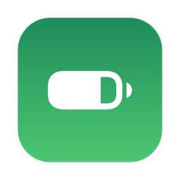
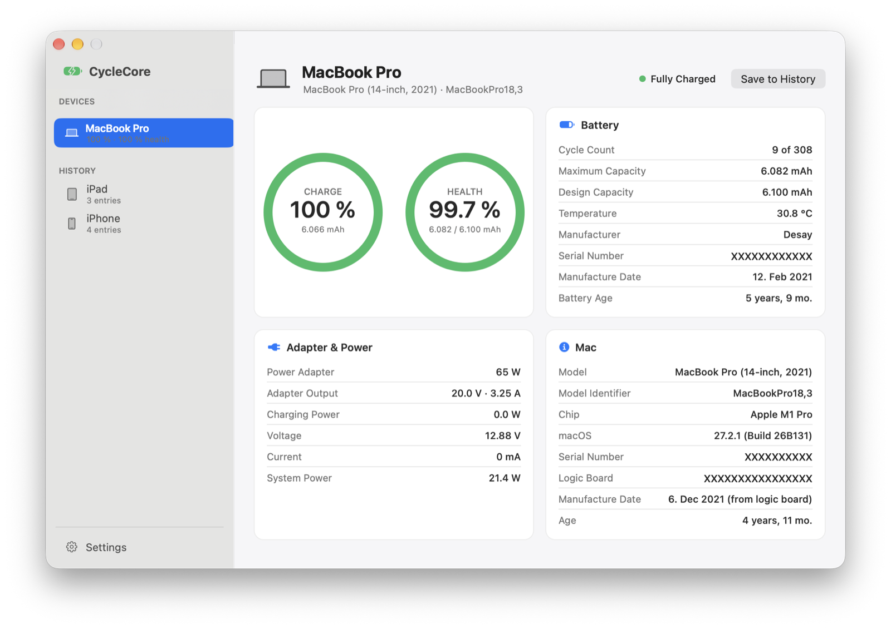

# CycleCore – Battery Health Monitor for Mac, iPhone and AirPods

Battery health monitor for macOS. Shows health, cycle count and capacity history for your Mac, iPhone, iPad and AirPods. A free alternative to coconutBattery.

**Build:** macOS 13+, Xcode Command Line Tools → `./build_app.sh`

Feedback and ideas are welcome – just open an [issue](../../issues).

MIT License © sami_i04

---
coconutbattery alternative, battery health, battery cycle count, macbook battery, iphone battery health, airpods battery, battery monitor, swift, macos
